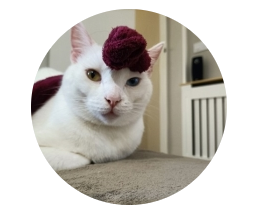

Me llamo Natalia Arce, este es mi gato Melo.  
Soy alumna de 2º de ASIR, en este blog estoy documentando la práctica 2.1 sobre servidores WEB, contenedores y despliegue continuo.  
**Tecnologías que estoy usando:** Linux, Apache, Nginx, Docker y Git.